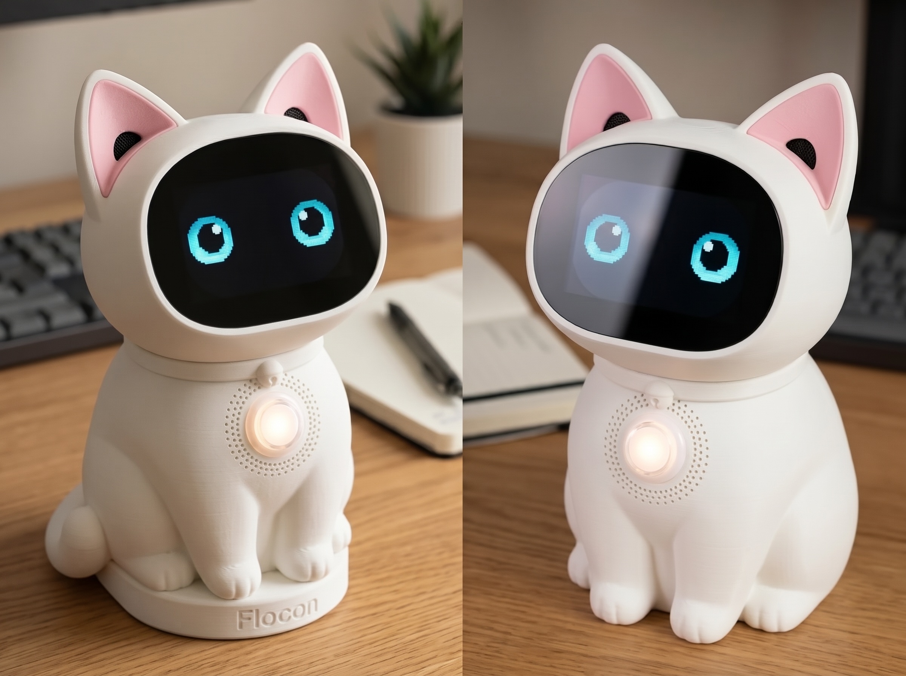
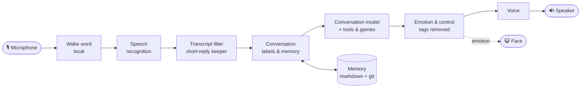

<div align="center">

# aipet

**Voice AI pets for children, in French.**
A little imaginary companion that chats, tells stories, plays games and remembers the children it has met,
running on a Raspberry Pi or in a browser.

[](https://github.com/BenTeoNeb/aipet/actions/workflows/ci.yml)
[](LICENSE)

[](https://github.com/pipecat-ai/pipecat)



</div>

> [!NOTE]
> The pets speak **French** (personas, prompts and spoken text are French on purpose). The code, comments
> and this documentation are in English. Support for other languages is planned (see the [roadmap](#roadmap)).

## Contents

- [Why](#why) · [Features](#features) · [Meet the pets](#meet-the-pets)
- [Quick start](#quick-start) · [Configuration](#configuration) · [Create your own pet](#create-your-own-pet)
- [How it works](#how-it-works) · [Parents' space](#parents-space) · [Privacy and child safety](#privacy-and-child-safety)
- [Raspberry Pi](#raspberry-pi) · [Development](#development) · [Roadmap](#roadmap) · [License](#license)

## Why

Voice assistants are built for adults: they answer and forget. A child wants a *friend*: someone with a
personality, who remembers their name and the story from yesterday, who plays fair, who gets sleepy at
bedtime, and who never pretends to be alive. aipet is that friend, designed with parents in the loop.

## Features

- **A real character.** Each pet has a persona, moods and rituals, shown on an animated face. It grows
  with the children: they choose its favourite colour or its nickname, teach it words, and it keeps a
  « Ma vie » journal of its own little life. It always says it is an imaginary pet.
- **Long-term memory.** Each pet remembers each child (likes, school class, what they are learning,
  stories in progress) in local markdown files versioned with git. New names are always confirmed
  before being used, and anything can be forgotten on request.
- **Games refereed by code, not by the model:** quiz, *ni oui ni non*, *devine à quoi je pense*,
  interactive stories with recurring characters, and short discovery lessons adapted to the child's
  school level, with scores and records per child.
- **A sense of time.** The pet knows the time of day, school days and school holidays, gets tired
  after a while, naps, and sleeps at night. It hangs up when it falls asleep or when the child says
  goodbye, so the conversation really ends.
- **Natural turn-taking.** Short answers are kept while the pet talks, a « hmm… » covers slow replies,
  noise and speech not meant for the pet are ignored.
- **A parents' space** to see who talked to the pet and about what, review the moments worth a look,
  and correct the pet's memory in one click.
- **Provider-agnostic.** Speech recognition, conversation model and voice are chosen in `config.toml`
  (OpenRouter by default; Google, Anthropic, OpenAI-compatible APIs and ElevenLabs are supported).

## Meet the pets

| | Pet | Personality |
|---|---|---|
| 🐱 | **Flocon** | A white kitten who knows a lot but has lived almost nothing. Collects the words children teach him and dreams of real snow. |
| 🦉 | **Plume** | A little owl who collects the children's « pourquoi ». Has never seen a rainbow: they always come while she sleeps. |

Each pet has **its own memory**: a new pet meets the children as strangers and learns their names by itself.

## Quick start

**Requirements:** Python 3.11, [uv](https://docs.astral.sh/uv/), an [OpenRouter](https://openrouter.ai)
API key, and a browser with a microphone.

```bash
git clone https://github.com/BenTeoNeb/aipet.git && cd aipet
cp .env.example .env        # then set OPEN_ROUTER_API
uv sync
uv run pet-web              # open http://localhost:7860 and press the button to talk
```

| Command | What it does |
|---|---|
| `uv run pet-web` | Web page with the pet's face (press <kbd>D</kbd> for the debug panel) |
| `open http://localhost:7860/parents` | Parents' space |
| `PET_CHARACTER=plume uv run pet-web` | Talk to another pet (with its own, at first empty, memory) |
| `uv run pet-headless` | Microphone and speaker, with a wake word (`--no-wake` to disable) |
| `uv run pet-analyze --days 7` | Latency, tool use and errors from the session logs (no API call) |

## Configuration

Everything lives in [`config.toml`](config.toml), with a comment on every key. The usual changes:

| To change | Where |
|---|---|
| Which pet | `character = "flocon"` (or `PET_CHARACTER`) |
| Models and providers, per role | `[engines.stt]`, `[engines.conversation]`, `[engines.preparation]`, `[engines.condensation]`, `[engines.tts]` |
| Bedtime, school-holiday zone | `[rhythm]` |
| How long children can talk before the pet gets tired | `[energy]` |
| Noise sensitivity, interruptions | `[listening]` |
| Household facts (never the children's names: each pet learns them) | `[family].info` |
| Voice and transcription prices for the cost view | `[costs]` |

API keys go in `.env` (see [`.env.example`](.env.example)); any engine can also be overridden with
`PET_<ROLE>_<PROVIDER|MODEL>` environment variables.

## Create your own pet

A pet is a folder of data in [`characters/`](characters/), no code:

```
characters/<id>/
  character.toml   name, grammatical gender, voice (one style per emotion), spoken lines (naps,
                   night, nudges…), what children may choose for it ([life]), wake word
  persona.md       who the pet is: story, quirks, rituals, how it reacts (French)
  face/            face.svg + face.css: the animated face, one pose per emotion
  skills/          optional: the pet's own version of an activity
```

Copy `characters/plume/`, rewrite it, and run `uv run pytest`: every pack is checked automatically
(it loads, keeps every safety rule, has every line and a face, and never leaks another pet's name).
The guardrails, emotions and tools stay in the core, so a new pet cannot weaken them.

## How it works



Built on [Pipecat](https://github.com/pipecat-ai/pipecat). The main pieces:

- **Engines** ([`aipet/engines.py`](aipet/engines.py)): one provider and model per role (speech
  recognition, conversation, preparation of stories and quizzes, memory condensation, voice). No
  other module knows about providers.
- **Conversation** ([`aipet/conversation.py`](aipet/conversation.py)): between the child's words and
  the model, it labels each message (who speaks, short hints such as « bientôt l'heure de dormir »),
  keeps the system prompt current and reacts to the pet's control tags. It coordinates small parts
  that each own one concern: speakers, sleep and goodbyes ([`sleep.py`](aipet/sleep.py)), presence,
  the tools sent to the model ([`tool_gate.py`](aipet/tool_gate.py)), memory condensation and the
  activities. [`session.py`](aipet/session.py) runs one conversation from start to end (web page or
  Pi), and [`hangup.py`](aipet/hangup.py) lets the pet end it by itself.
- **Memory** ([`aipet/memory/`](aipet/memory/)): conversations are condensed into per-child cards,
  daily memories, the pet's own life and a summary that stays in the prompt; the pet can search and
  read its memory with tools. Each pet's data lives in `~/.aipet/pets/<id>/`.
- **Activities** ([`aipet/builtin_skills/`](aipet/builtin_skills/)): plain-French `SKILL.md` files;
  only their one-line descriptions are always in the prompt, the full instructions and tools load
  when the activity starts. Families can add their own in `~/.aipet/skills/`.
- **Games** ([`aipet/games/`](aipet/games/)): scores, question counts, story plans and records are
  kept by code, so the model cannot claim a win it did not earn. Preparing a story, quiz or lesson
  runs in the background: a child talking meanwhile gets an answer instead of cancelling it.
- **Turn-taking** ([`aipet/turns.py`](aipet/turns.py)): while the pet is silent, the child's turn
  starts on voice and Pipecat's Smart Turn model decides when the sentence is finished; while it
  speaks, interrupting it takes a few words, so noise never cuts it off.
- **Control tags** ([`aipet/emotions.py`](aipet/emotions.py)): each reply starts with an emotion
  (which drives the face and the voice style), and may say who is speaking or that the speech was not
  for the pet. Tags are never spoken.
- **Rhythm and energy** ([`aipet/rhythm.py`](aipet/rhythm.py), [`aipet/energy.py`](aipet/energy.py)):
  official French school calendar, tiredness, naps and night sleep (answered with a sleepy « zzz »
  without calling any model).

<details>
<summary>Project layout</summary>

```
aipet/
  config.py, env.py, paths.py   configuration, .env and PET_* variables, per-pet folders
  fileio.py, tasks.py, timefmt.py  locks and atomic writes; background tasks; clock and French dates
  character.py                  character packs (load and check)
  prompts.py                    system prompt (French) and startup safety check
  pipeline.py                   pipeline shared by the web and headless modes
  session.py, hangup.py         one conversation's lifecycle; the pet hanging up by itself
  conversation.py               labels, system prompt, control tags (coordinates the parts below)
  sleep.py, presence.py         sleep, good night and goodbye; when each child last talked
  tool_gate.py                  tools sent to the model, per-turn budget, tool handlers
  engines.py, openrouter_tts.py speech recognition, models and voice providers
  memory/                       store (Memory), cards (file format), updates, forget, repo (git),
                                condensation (keeper), tools, speakers, « Ma vie » moments
  games/                        quiz, yes/no, guess, story, learn (common.py: Activity, Host)
  skills.py, builtin_skills/    SKILL.md activities
  rhythm.py, energy.py          time, school calendar, tiredness
  turns.py, cleanup.py          turn-taking, transcript and spoken-text filters
  emotions.py                   emotion and control tags
  wake.py                       wake word (openWakeWord)
  session_log.py, monitoring.py session logs; latency, costs, errors
  parents.py                    parents' space
  web.py, static/               web server, pet page, parents' page
  headless.py                   Raspberry Pi entry point
characters/                     the pets
frontend/                       source of the bundled Pipecat JS client
deploy/                         Raspberry Pi deploy script and systemd unit
tests/                          pytest suite (no network)
```

</details>

## Parents' space

`http://localhost:7860/parents` (in French), computed locally from the session logs and the pet's memory:

- **Aujourd'hui**: who talked to the pet, when and for how long, the games and stories with their
  results, the pet's energy. Any past day can be chosen.
- **Conversations**: each session as a readable chat, with the pet's emotions and the activities,
  filterable by child.
- **À vérifier**: the moments worth a look over the last two weeks (sadness, confidences, swear words,
  unknown names, noise taken for a child, games given up early, failures), marked as seen once read.
- **Mémoire**: the children's cards, the pet's life, its summary, game records and story characters,
  each item correctable or removable; every correction is committed to the memory's git history and
  the pet takes it into account at once.

The debug panel (<kbd>D</kbd> on the pet page) adds the live context, past sessions, latency per turn
(transcription, end-of-turn detection, model, voice), daily costs and errors.

## Privacy and child safety

> [!IMPORTANT]
> With cloud engines, **the children's speech leaves the device.** Read this before using aipet at home.

- **What is sent where.** With the default engines, audio and text go to OpenRouter, then to OpenAI
  (speech recognition), Google (conversation, preparation, memory) and Mistral (voice). OpenRouter is
  asked to route only to providers that neither keep nor train on the data (`data_collection = "deny"`).
- **What stays local.** Long-term memory (`~/.aipet/pets/<id>/memory`, markdown + git), session logs
  (deleted after 30 days) and raw transcripts. Nothing of it is ever committed to this repository.
- **On the Raspberry Pi** only the wake word runs locally: while the pet sleeps, no audio is sent
  anywhere. The web page streams while a conversation is open.
- **Forgetting.** A « forget » request removes the information from the memory, from its git history
  and from the logs; parents can also remove anything from the parents' space.
- **Guardrails.** Fixed safety rules in the prompt, checked at startup together with the exact list
  of tools; a tool-call budget per turn; content filters set explicitly for Gemini (sent through
  OpenRouter, but not proven to be applied there, so the prompt rules remain the main defence);
  confidences never repeated to another child; rude words never added to the pet's vocabulary.
- **Honesty.** The pet never claims to be alive, and says simply that it is an imaginary pet living
  in a little talking box.
- **Local access only.** The debug panel and the parents' space answer only the locally served page.

## Raspberry Pi

```bash
./deploy/deploy-pi.sh my-pi.local    # SSH host of the Pi (default: raspberrypi.local)
```

The script installs the system packages and uv, syncs the code **and `.env`** (so the API key ends up
on the device: use a key with a spending limit), and installs the `aipet` systemd service
(`journalctl -u aipet -f` for the logs).

## Development

```bash
uv sync
uv run pytest                                   # ~15 s, no network access
uv run ruff check . && uv run ruff format --check .
cd frontend && npm ci && npm run build          # only when updating the Pipecat JS client
```

Tests fake every model and audio service, and fail on any non-local connection, so running them never
costs anything. Checks against real models are done by hand, outside the suite. CI runs the lint and
the tests on every push.

Contributions are welcome: see [CONTRIBUTING.md](CONTRIBUTING.md).

## Roadmap

- **Expressive voice:** real laughs and sighs, softer and slower bedtime stories, word emphasis
  (Pipecat's expressive conversation with a TTS that supports it). Today each sentence gets a voice
  style from its emotion.
- **Faster interruptions:** when a child talks over the pet, the turn still waits a fixed delay
  for the transcription (~1.8 s); a streaming transcription would remove it.
- **Backup model** when the conversation model is slow or down.
- **A distinct voice per pet** (Voxtral has a single French voice today).
- **Other languages:** locale bundles for every model-facing text, the pet's language set in its
  pack, and the household's country (school system, holidays) kept separate.
- **Custom wake words** (« hey Flocon »), and echo cancellation on the Pi so children can interrupt.
- **Parents' space on the home network**, protected by a parent code.

## License

aipet is free software, licensed under the **[GNU Affero General Public License v3.0](LICENSE)**: you
may use, study, modify and share it, provided that any modified version you distribute **or run as a
network service** is published under the same license, with its source code.

**Commercial license.** If you want to use aipet in a product or service without the AGPL's
obligations, a commercial license is available: open an issue or contact
[the author](https://github.com/BenTeoNeb).

Copyright © 2026 Benjamin Farcy. The bundled JavaScript client keeps its own licenses
(MIT, BSD-2-Clause, Apache-2.0, 0BSD): see [THIRD_PARTY_NOTICES.md](THIRD_PARTY_NOTICES.md).

## Acknowledgements

- [Pipecat](https://github.com/pipecat-ai/pipecat), the real-time voice framework aipet is built on.
- [Pistache](https://github.com/clapeyre/pistache), a friend's voice companion for kids (MIT), for
  several ideas: text safety nets and the startup safety check.
- [openWakeWord](https://github.com/dscripka/openWakeWord) and [Silero VAD](https://github.com/snakers4/silero-vad).
