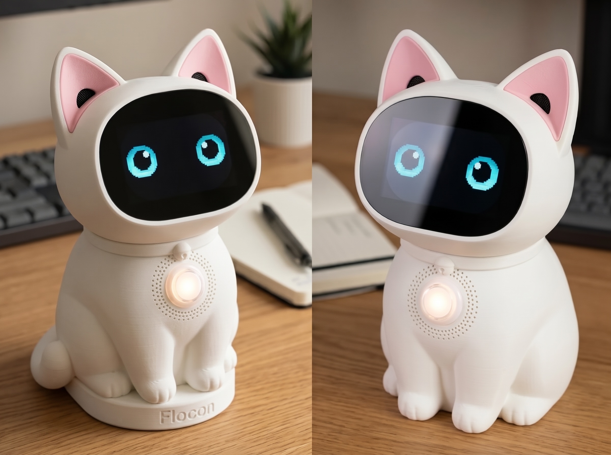

# Flocon — visual identity

Concept render (AI-generated, November 2026). The reference for the device, the web face and
any future artwork.

## Key elements

- **Body:** a small, sitting white cat with a smooth, matte, 3D-printed look; soft rounded
  shapes, front paws together, tail curled at the side.
- **Ears:** pink inner ears; the speaker grilles sit inside them.
- **Face:** a rounded black screen in place of the face. Flocon's expressions live there.
- **Eyes:** large round pixel-art eyes in light cyan, each with a white highlight. No mouth or
  nose on the screen in this concept.
- **Collar:** a thin collar with a little bell under the chin.
- **Chest:** a round button that glows warm white (the listening/status light), surrounded by
  a ring of microphone holes.
- **Base:** a round plinth with "Flocon" engraved.

## Palette (approximate)

| Role | Color |
|---|---|
| Body | warm white `#F4F1EC` |
| Inner ears | soft pink `#F2B8C6` |
| Screen | black `#0B0B0F` |
| Eyes | cyan `#5FD3E6`, highlight white |
| Status light | warm white glow `#FFE9D2` |

The current web page (`flocon/static/index.html`) still shows an earlier cartoon cat face; it
can be aligned with this identity (black screen face, cyan pixel eyes) later.
