# How StoryWorld works

StoryWorld runs spoken adventure games in three roles: the **Narrator** tells the story, the
**Engine** holds the truth of the world, and the **Intent Reader** turns what the player says into
actions the Engine can play. Each concept below has one name, defined once in the
[Lexicon](#lexicon) and used everywhere after.

The Engine is this library (`storyworld/`). The Narrator's tools and the Intent Reader are, for
now, implemented by the host application (`aipet/games/adventure.py`,
`aipet/games/adventure_intent.py`); this page describes the contract between them. The format is
in [SPEC.md](SPEC.md), the API and the guarantees in [README.md](README.md).

## Contents

1. [Lexicon](#lexicon)
2. [The three roles](#the-three-roles)
3. [What an adventure is](#what-an-adventure-is)
4. [The lifecycle of an adventure](#the-lifecycle-of-an-adventure)
5. [The Intent, and the tools that carry it](#the-intent-and-the-tools-that-carry-it)
6. [A Turn, today](#a-turn-today)
7. [The Turn Pipeline](#the-turn-pipeline)
8. [Outcomes](#outcomes)
9. [Helping the player](#helping-the-player)
10. [The target: read, play, tell](#the-target-read-play-tell)
11. [Cases](#cases)
12. [What computes, and when](#what-computes-and-when)

## Lexicon

**The three roles**

| Name | Meaning |
|---|---|
| **Narrator** | The language model that talks with the player. Today it also decides the actions (by calling the tools); in the target it only tells, chats and asks. |
| **Intent Reader** | A decision model (today TypeSafe's Jev 1.14) that reads one sentence and answers multiple-choice questions about it. It writes nothing; it returns choices with probabilities. |
| **Engine** | StoryWorld's core: holds the World and the State, plays each Intent, returns an Outcome. The only source of truth. |

**The game's data**

| Name | Meaning |
|---|---|
| **World** | An adventure as written (the graph, [SPEC.md](SPEC.md)): places, things, characters, Actions, puzzles, endings. It never changes during a game. |
| **State** | Where one game stands: the hero's place, the bag, what is open, flags, actions done, clues met, the ending if any (`model.State`). Saved between sessions. |
| **Action** | A rule of the World written by the author: Triggers (the verb and things that do it), conditions (`has:framboises`), effects (`reveal:ocre`). |
| **Id** | The stable name of a thing, place or character (`patapouf`, `riviere`). The Engine reads ids, never words. |

**One turn**

| Name | Meaning |
|---|---|
| **Turn** | One sentence of the player and everything it causes, up to the Narrator's spoken answer. |
| **Intent** | One action of the hero, by ids: `{verb, object, target, to}`. A sentence can hold several, played in order. |
| **Reach List** | `à_portée`: the ids the player can name this Turn (things here, in the bag, held by someone, the ways out), with their names (`World.in_reach`). |
| **Outcome** | The Engine's verdict on one Intent: `done`, `not_yet`, `free`, `warning`, `end`… with texts. The Narrator tells it and never contradicts it. |
| **Turn Pipeline** | The fixed stages the Engine runs for each Intent (`turn.Turn.act`), named [below](#the-turn-pipeline). |

**Helping the player**

| Name | Meaning |
|---|---|
| **Stall Counter** | Counts tries that led nowhere (`State.stalled`). At a threshold (3, 4 or 6 by difficulty) the player gets a Reminder, then Hints. |
| **Hint Ladder** | Three levels for the next useful step: where the clue is, which thing, what to do (`hints.py`). Aimed at the puzzle the player is trying. |
| **Game Master's Screen** | `écran_mj`: the steps the hero is ready for, attached to a failed or free try that comes close to one (`View.gm_screen`). Private to the Narrator. |
| **Improvise** | A creative idea played as a step of the Game Master's Screen: the Engine does the planned step, the Narrator tells the player's idea. |
| **Think Twice** | Before destroying a thing the mission needs, the story makes the hero hesitate once (`Turn.think_twice`). If the player insists, it happens. |
| **Doom Check** | After a destroy, is a win still reachable? If not, the game ends when the player runs into it (`Turn.detect_doom`). |
| **Checkpoint** | `sauvegarde`: the State just before a losing move; the player may retry from it (unlimited, 3 or 1 by difficulty). |

**Proofs and speed**

| Name | Meaning |
|---|---|
| **Solver and Checker** | Before an adventure is played (`validate`): every reachable State is explored; it must be winnable fairly (a code only after its clue is met), and the Turn must play every move as the proof expects. |
| **Atlas** | Every reachable State with its fair distance to a win, built once per adventure and kept on disk (`atlas.py`). "Can the player still win from here?" becomes a lookup. |

**The Intent Reader**

| Name | Meaning |
|---|---|
| **Confidence Gate** | The Intent Reader's decision is played only if its lowest confidence is at least 0.7. Below, the Turn goes to the Narrator. |
| **Clarification** | When the sentence is unclear, the Narrator asks, offering the options the Intent Reader hesitated between ("the donkey or the cart?"). |
| **Fixed-Choice Limit** | The Intent Reader only picks ids offered this Turn: it cannot name a thing that is not in the Reach List yet. |
| **False Action** | The Intent Reader confident on an action where none was meant (chit-chat read as a move): the main risk to measure. |
| **Shadow Mode** | The Intent Reader reads every sentence in the background; its reading is logged next to the Narrator's (`adventure_intent_shadow`) and never played. |

## The three roles

The rule that holds everything together: **the Engine is the only source of truth**. The Narrator
never decides whether something works and never creates a thing, a place or a passage; it tells the
Outcome. The Intent Reader only turns words into Intents.

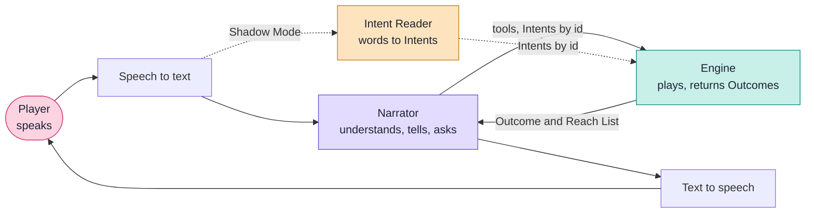

| Role | Does | Never |
|---|---|---|
| Narrator | Today: reads the sentence and calls the tools with Intents by id. Tells the Outcome with voices, sound effects and characters ("yes, and…"). Asks when unsure. | Decides success, invents a thing or a way, gives the solution unasked. |
| Intent Reader | Answers how many actions, then each action's verb, object, target and place, as choices among this Turn's ids, with probabilities. Today in Shadow Mode. | Writes text, sees the Game Master's Screen, names a thing outside the Reach List. |
| Engine | Plays each Intent through the Turn Pipeline; runs the world's reactions, the Hint Ladder, Think Twice, the Doom Check. Its Solver proves each adventure winnable before it is played. | Guesses what a word means: it expects ids. |

## What an adventure is

A World is a small graph, written by an author or generated (in French today). The State is a
separate, small record of where one game stands.

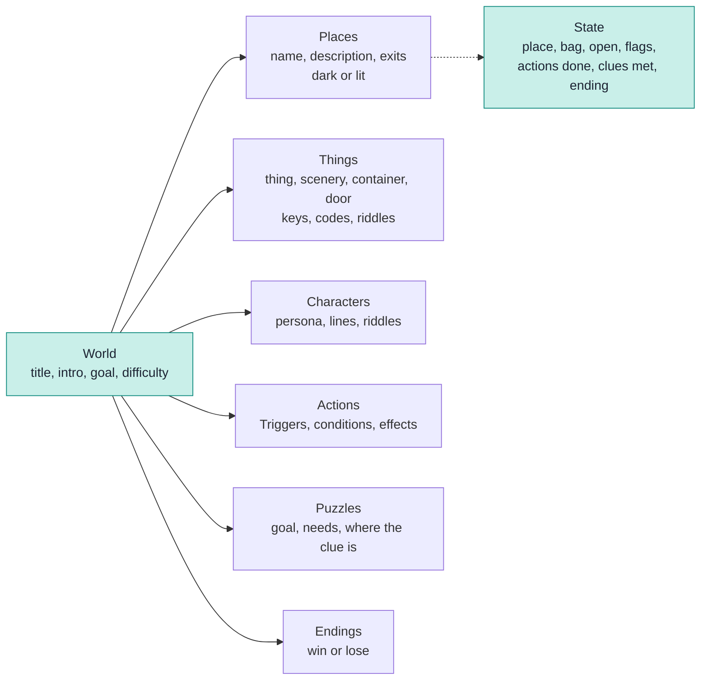

An Action, as written (« La grotte aux peintures d'Oukou »):

```json
{
  "id": "donner_framboises",
  "triggers": [{"verb": "give", "object": "framboises", "target": "patapouf"}],
  "when": ["has:framboises"],
  "effects": ["lose:framboises", "set:patapouf:content", "reveal:ocre"],
  "hint": "Patapouf est assis sur l'ocre… Qu'est-ce qu'il aime le plus au monde ?"
}
```

Conditions: `has`, `flag`, `at`, `visited`, `is`… Effects: `gain`, `lose`, `reveal`, `flag`,
`set`, `goto`, `end`… (`rules.py`). The World also has:

- **Built-in behaviours**: taking, opening with a key, pressing a code, answering a riddle, the
  senses (listen, smell, touch), the bag. No Action needed (`builtins.py`).
- **Reactions** (`after`): what the world does right after an event (the dragon wakes up when the
  hero enters).
- **Clues**: a code or a riddle is fair only once its clue was met; the Solver checks it.
- **Difficulty**: facile, moyen, difficile set the size, the Stall threshold and the number of
  Checkpoints (`profiles.py`).

## The lifecycle of an adventure

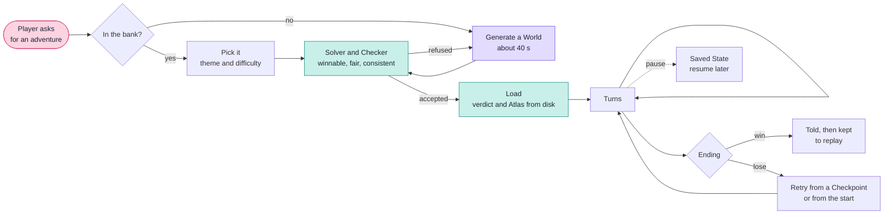

## The Intent, and the tools that carry it

« Je cueille les framboises et je les donne à Patapouf » becomes two Intents:

```json
[{"verb": "take", "object": "framboises"},
 {"verb": "give", "object": "framboises", "target": "patapouf"}]
```

Every value is an id from the Reach List (or a place id for `to`). If the first Intent fails, the
rest is not played and the Outcome says so (`pas_fait`). The Reach List sent back after each move:

```json
"à_portée": {
  "framboises": "des framboises",
  "patapouf": "Patapouf le bébé mammouth",
  "torche": "une torche allumée (dans ton sac)",
  "campement": "→ vers le campement (ouest)"
}
```

The Narrator's tools:

| Tool | Used for | Main parameters | Returns |
|---|---|---|---|
| `adventure_start` | Start, resume, replay, retry from a Checkpoint | `title`, `difficulty`, `resume`, `replay`, `from_checkpoint`, `new`, `idea` | Title, intro, goal, the first place; or "preparing the world" while one is generated |
| `adventure_act` | Every action of the hero | `actions`: a list of Intents (plus `step` for Improvise); `said`; `remember` and `about` to keep an invented detail | One Outcome per Intent, the Reach List, `pas_fait`, a Reminder or a Hint when stalled |
| `adventure_end` | After the ending, or to stop | `reaction` | The adventure is kept to be replayed |

Every action of the hero goes through `adventure_act`, even when the Narrator thinks it knows the
answer.

## A Turn, today

A real Turn (21 November 2026): « Aller au bord du Nil. » The Narrator needs two calls, one to pick
the Intent and one to tell the Outcome, because it cannot tell before the Engine has played. In
Shadow Mode the Intent Reader reads the same sentence on its own copy of the World, and the log
compares the two at the next sentence.

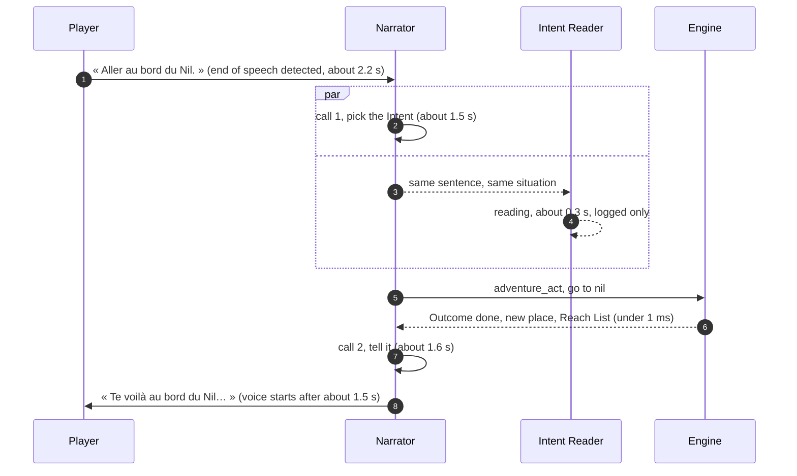

6.8 s felt on this Turn. Over 67 recorded adventure Turns: 49 with 2 Narrator calls, 15 with none
(chat), 3 with 3 or more. The Engine takes about 3 ms.

## The Turn Pipeline

Each Intent goes through the same named stages, in this order (`turn.Turn.act`). In the middle, the
first stage that can answer does; the later stages always run.

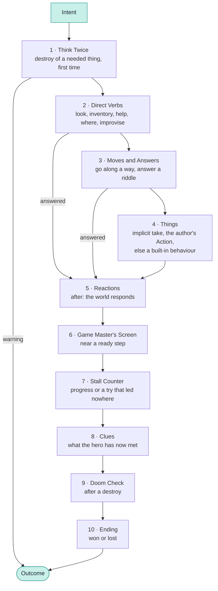

| Stage | What it does | Example | Code |
|---|---|---|---|
| 1 · Think Twice | Before a destroy that would make the mission impossible: once, a `warning` with "précieux". The same Intent again goes through. | Throwing the only key into the sea | `Turn.think_twice` |
| 2 · Direct Verbs | Verbs that need no thing answer at once. | "What's in my bag?" | `Turn.special` |
| 3 · Moves and Answers | Going along a way (by place, label or direction; a closed door opens on the way if it can); answering a riddle. | "Go north", "It's a comb" | `Turn.go_or_answer`, `ways.py` |
| 4 · Things | Takes what the Intent needs in hand, then the author's Action whose Trigger matches, else a built-in behaviour. | Give the raspberries (picked up first) | `Turn.perform`, `actions.py`, `builtins.py` |
| 5 · Reactions | The World's `after` rules, in the order things happened, until nothing more fires. | Entering the cave wakes the bats | `World.react` |
| 6 · Game Master's Screen | On a failed or free try about the things of a ready step: that step, privately, for Improvise. | "Use the torch on the raspberries" | `Turn.screen` |
| 7 · Stall Counter | Progress resets it; a try that led nowhere increments it and remembers what it was about. | 3 failed tries, a Reminder | `Turn.count_progress` |
| 8 · Clues | Marks the clues the hero has now seen, so codes and riddles become fair. | Seeing the drawing in the sand | `World.learn` |
| 9 · Doom Check | After a destroy, every progress Turn checks a win is still reachable. | The second key traded away | `Turn.detect_doom` |
| 10 · Ending | Win (scores) or lose (with a Checkpoint just before). | Banging the drum | `Turn.tell_ending` |

## Outcomes

The contract between the Engine and the Narrator:

| Outcome | Meaning | The Narrator… |
|---|---|---|
| `done` | It worked; `ensuite` lists what the world did right after | tells it, describes a new place |
| `already` | Already done | kindly recalls what is left |
| `not_yet` | Not yet, with the author's hint | says no, with that hint |
| `impossible`, `no_exit` | No, for a reason of the world | "no, but…", and an open door |
| `absent` | Not in this adventure | plays along, without it mattering |
| `free` | Not planned: a free moment (maybe with the Game Master's Screen) | one or two funny sentences, then back to the situation |
| `clue` | A red herring or a joke the author planned | tells it with humour |
| `ask` | The Engine needs a choice ("which way?") | asks it |
| `hint` | The next rung of the Hint Ladder | slips it in through a character or a detail |
| `warning` | Risky; with "précieux", Think Twice | warns, or makes it felt in the story; if the player insists, plays the same Intent again |
| `end` | Won or lost | tells the ending and the "Did you know?", offers a Checkpoint |

## Helping the player

Never stuck, never told the answer.

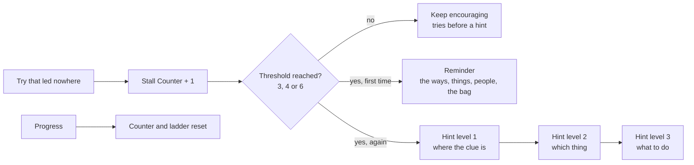

- **Hint Ladder**: aimed first at the puzzle the player is trying (the things of their last
  tries), if that brings a win closer; otherwise at the next useful step of the shortest way to
  win. Its search is bounded so the player never waits long.
- **Game Master's Screen and Improvise**: when a try comes close to a ready step, the Narrator
  privately sees that step. If the player's idea really does it with the things it names, the
  Narrator plays Improvise: the Engine does the planned step (so the adventure stays proven
  winnable) and the story tells the player's idea.
- **Think Twice, Doom Check, Checkpoint**: a destroy that would doom the mission makes the hero
  hesitate once. If it happens anyway, the Doom Check ends the game gently when the player runs
  into it, and a Checkpoint lets them retry from just before.

## The target: read, play, tell

Every sentence goes to the Intent Reader first. Past the Confidence Gate, the Engine plays and the
Narrator makes a single call to tell it. Below it, the Narrator handles the Turn: chat, or a
Clarification.

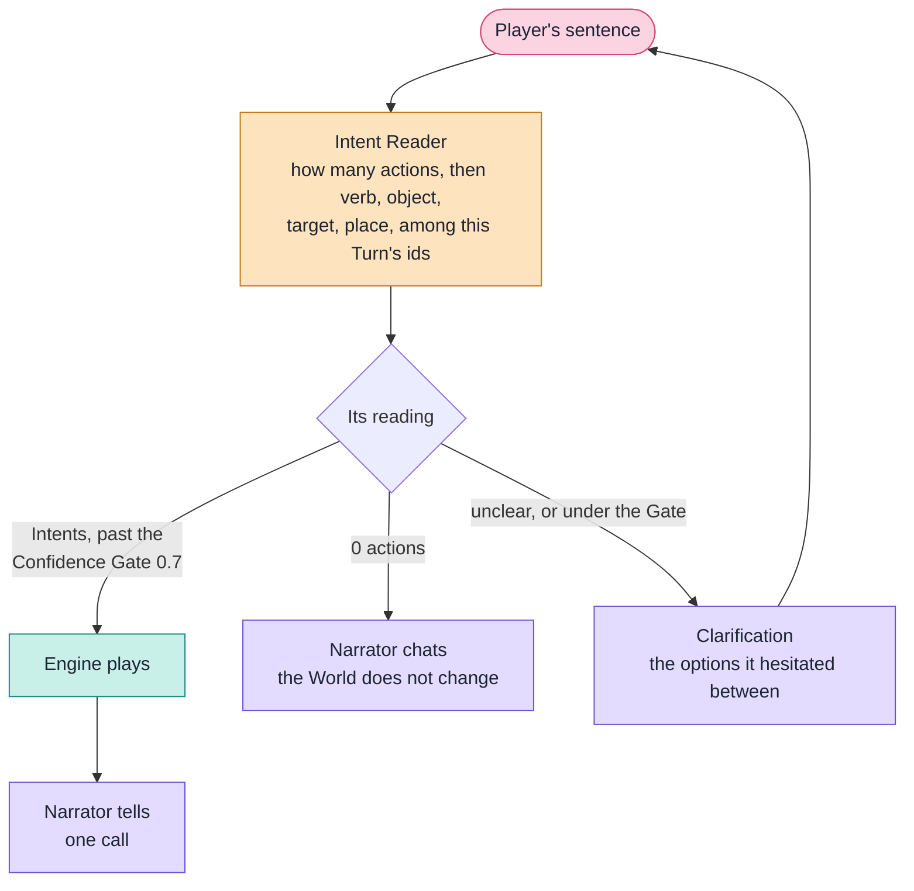

On the intent benchmark ([docs/adventure/intent-bench](../docs/adventure/intent-bench/README.md):
701 sentences, each attached to a real State, the truth checked in the Engine), on the held-out
test set (288 sentences): 50 % of Turns pass the Confidence Gate, and 97.2 % of those are right
(two independent labellings agree on 94 %). That saves about 1.2 s on those Turns, for about
$0.0002 per Turn through a zero data retention endpoint. Before switching, Shadow Mode measures real
games, especially False Actions.

## Cases

**« Qu'est-ce que j'ai dans mon sac ? »** ("What's in my bag?")

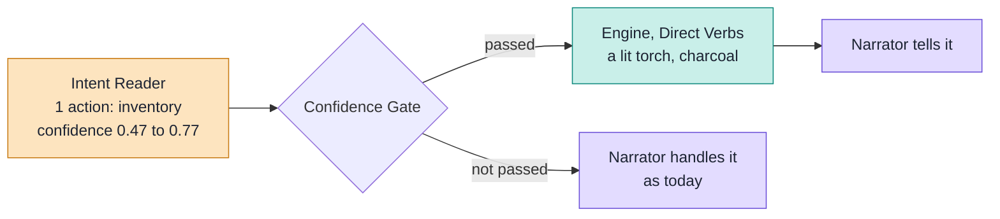

The World does not change. On the benchmark: "inventory" 5 times out of 6, not always past the Gate.

**« Je cueille plein de framboises et je les donne à Patapouf »** ("I pick lots of raspberries and
give them to Patapouf.")

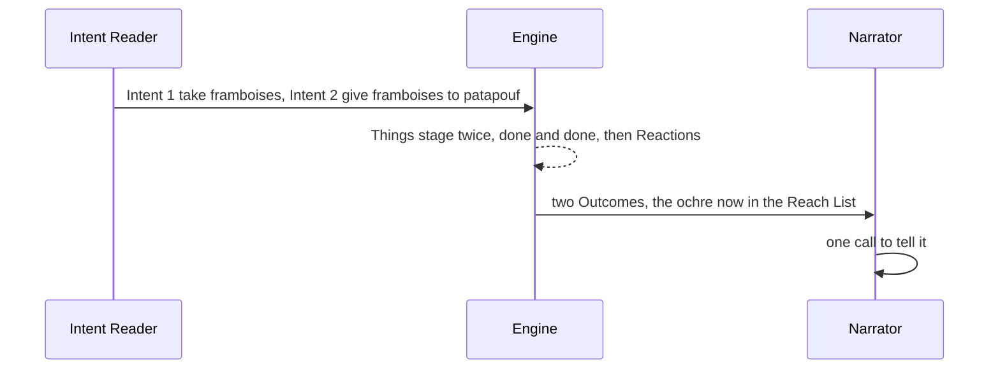

**« Je prends ça »** ("I take that.")

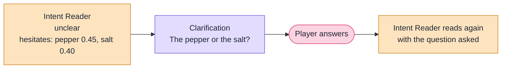

Nothing is played until it is clear.

**« Bulle, t'as peur du noir toi ? »** ("Bulle, are you scared of the dark?") Chit-chat with a
character: the right reading is 0 actions; the Narrator plays Bulle with its persona and the World
does not move. A confident action here (lighting the torch) would be a False Action; Shadow Mode
counts them.

**« Je tape sur le gros tambour ! »** ("I bang the big drum!", an Action that ends the game, lost)

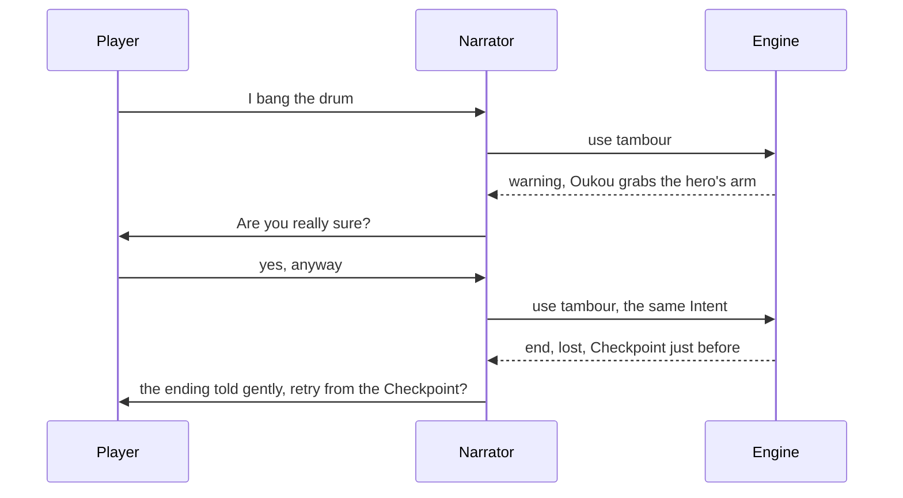

**« J'ai une idée ! Je les cueille avec ma torche et je les lance dans sa bouche comme au
basket »** ("I have an idea! I pick them with my torch and throw them into his mouth like
basketball.") The Game Master's Screen shows the ready step `donner_framboises` ("Patapouf moves
off the ochre"). The Narrator plays Improvise with that step and the things the player named; the
Engine does the planned step, picking up the raspberries on the way; the story tells the basketball
shot. In the target this Turn stays with the Narrator: the Intent Reader does not see the Screen.

**« Je vais au campement et je prends la torche »** ("I go to the camp and take the torch.") The
torch is at the camp, so it is not in the Reach List yet: the Fixed-Choice Limit. About 6 % of the
benchmark's sentences hit it, and the Intent Reader is rarely past the Gate on them. The Narrator
chains instead: it plays the move, gets the new Reach List, then takes the torch. A far place
already seen is not a problem: the route is walked along the open ways.

## What computes, and when

| Computation | When | Cost | Today |
|---|---|---|---|
| Solver and Checker | at load | 1 to 3 s for the biggest | verdict kept on disk per adventure and Engine version |
| Atlas | at load, in the background | ≤ 1.5 s to build, 0.24 s to read back | kept on disk; compared with the searches in Shadow Mode |
| Hint Ladder search | help asked, or Stall threshold | up to about 0.2 s, sometimes more | a search; the Atlas can answer in microseconds |
| Think Twice, Doom Check | rare: a destroy | up to a few hundred ms | a search (these States are off the Atlas) |
| Turn Pipeline | every Intent | a few ms | negligible |

Most of a Turn's wait is elsewhere: end-of-speech detection (about 2.2 s), the two Narrator calls
(about 1.5 s each) and the voice (about 1.5 s). The Intent Reader targets one of the two calls.
